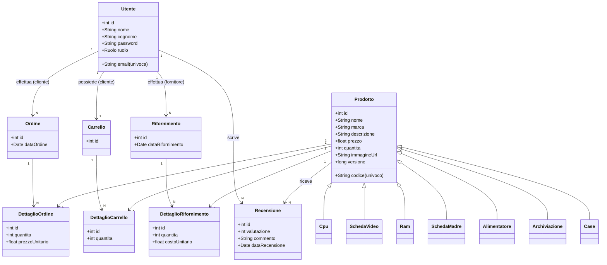

# Modello dei dati — E-commerce componenti PC

Documento di riferimento per il modello **Entità-Relazione** (concettuale) e il
**modello logico** (schema relazionale) del backend.

Package entità: `org.example.backend.entities` · DB: MySQL · Ereditarietà JPA: **JOINED**.

---

## 1. Modello Entità-Relazione (concettuale)

### 1.1 Entità e attributi

- **Utente** — chi usa la piattaforma. Il campo **ruolo** {CLIENTE, FORNITORE} distingue i due tipi.
  - id (chiave), nome, cognome, email (univoca, login), password, ruolo
- **Prodotto** *(entità generica / padre)* — un componente hardware in vendita.
  - id (chiave), nome, codice (univoco), marca, descrizione, prezzo, quantità (scorta), immagineUrl, versione
  - Specializzazioni (gerarchia IS-A): **Cpu**, **SchedaVideo**, **Ram**, **SchedaMadre**,
    **Alimentatore**, **Archiviazione**, **Case** — ciascuna con i propri attributi tecnici.
- **Carrello** — carrello di un utente (uno per utente). id (chiave)
- **DettaglioCarrello** — *associativa* (prodotto ↔ carrello): id, quantità
- **Ordine** — acquisto finalizzato da un cliente: id, dataOrdine
- **DettaglioOrdine** — *associativa* (ordine ↔ prodotto): id, quantità, prezzoUnitario (storicizzato)
- **Rifornimento** — rifornimento di magazzino fatto da un fornitore: id, dataRifornimento
- **DettaglioRifornimento** — *associativa* (rifornimento ↔ prodotto): id, quantità, costoUnitario
- **Recensione** — *associativa* (cliente ↔ prodotto): id, valutazione (1-5), commento, dataRecensione

### 1.2 Relazioni (associazioni)

| Relazione | Entità coinvolte | Cardinalità | Entità associativa |
|---|---|---|---|
| effettua | Cliente → Ordine | 1 : N | — |
| valuta | Cliente ↔ Prodotto | N : N | **Recensione** (max 1 per coppia cliente–prodotto) |
| possiede | Cliente → Carrello | 1 : 1 | — |
| contiene | Prodotto ↔ Carrello | N : N | **DettaglioCarrello** |
| composto da | Ordine ↔ Prodotto | N : N | **DettaglioOrdine** |
| effettua | Fornitore → Rifornimento | 1 : N | — |
| rifornisce | Prodotto ↔ Rifornimento | N : N | **DettaglioRifornimento** |
| IS-A | Prodotto → {Cpu, SchedaVideo, Ram, SchedaMadre, Alimentatore, Archiviazione, Case} | generalizzazione | — |

> Nota: Cliente e Fornitore sono lo stesso ente **Utente**, distinto dal campo `ruolo`.
> Le relazioni lato cliente (ordine, carrello, recensione) e lato fornitore (rifornimento)
> puntano quindi tutte a UTENTE.

### 1.3 Diagramma E-R

---

## 2. Modello logico (schema relazionale)

Legenda: **PK** = chiave primaria · **FK** = chiave esterna · **U** = univoco · **NN** = not null.
Gerarchia IS-A mappata in **JOINED**: ogni sottotipo ha `id` come **PK** e **FK** verso `PRODOTTO(id)`.

### UTENTE
| Colonna | Tipo | Vincoli |
|---|---|---|
| id | INT | **PK**, auto-increment |
| nome | VARCHAR | NN |
| cognome | VARCHAR | NN |
| email | VARCHAR | NN, **U** |
| password | VARCHAR | NN |
| ruolo | VARCHAR | NN (enum: CLIENTE, FORNITORE) |

### PRODOTTO (tabella base della gerarchia)
| Colonna | Tipo | Vincoli |
|---|---|---|
| id | INT | **PK**, auto-increment |
| nome | VARCHAR | NN |
| codice | VARCHAR | **U** |
| marca | VARCHAR | |
| descrizione | VARCHAR | |
| prezzo | FLOAT | NN |
| quantita | INT | NN |
| immagine_url | VARCHAR | |
| versione | BIGINT | NN (locking ottimistico) |

### CPU
| Colonna | Tipo | Vincoli |
|---|---|---|
| id | INT | **PK**, **FK** → PRODOTTO(id) |
| socket | VARCHAR | |
| numero_core | INT | |
| frequenza_base | FLOAT | |
| frequenza_boost | FLOAT | |
| tdp | INT | |

### SCHEDA_VIDEO
| Colonna | Tipo | Vincoli |
|---|---|---|
| id | INT | **PK**, **FK** → PRODOTTO(id) |
| chipset | VARCHAR | |
| vram_gb | INT | |
| tipo_memoria | VARCHAR | |
| tdp | INT | |
| lunghezza_mm | INT | |

### RAM
| Colonna | Tipo | Vincoli |
|---|---|---|
| id | INT | **PK**, **FK** → PRODOTTO(id) |
| capacita_gb | INT | |
| tipologia | VARCHAR | (DDR4, DDR5...) |
| frequenza_mhz | INT | |
| numero_moduli | INT | |
| latenza_cl | INT | |

### SCHEDA_MADRE
| Colonna | Tipo | Vincoli |
|---|---|---|
| id | INT | **PK**, **FK** → PRODOTTO(id) |
| socket | VARCHAR | |
| chipset | VARCHAR | |
| formato | VARCHAR | (ATX, mATX, ITX) |
| slot_ram | INT | |

### ALIMENTATORE
| Colonna | Tipo | Vincoli |
|---|---|---|
| id | INT | **PK**, **FK** → PRODOTTO(id) |
| potenza_watt | INT | |
| certificazione | VARCHAR | (80+ Bronze/Gold...) |
| modulare | BOOLEAN | |
| formato | VARCHAR | |

### ARCHIVIAZIONE
| Colonna | Tipo | Vincoli |
|---|---|---|
| id | INT | **PK**, **FK** → PRODOTTO(id) |
| capacita_gb | INT | |
| tipo | VARCHAR | (SSD, HDD, NVMe) |
| interfaccia | VARCHAR | (SATA, PCIe) |
| velocita_lettura | INT | (MB/s) |

### CASE_PC
| Colonna | Tipo | Vincoli |
|---|---|---|
| id | INT | **PK**, **FK** → PRODOTTO(id) |
| formato | VARCHAR | |
| numero_ventole | INT | |
| lunghezza_gpu_max | INT | (mm) |

### CARRELLO
| Colonna | Tipo | Vincoli |
|---|---|---|
| id | INT | **PK**, auto-increment |
| utente | INT | NN, **U**, **FK** → UTENTE(id) — relazione 1:1 |

### DETTAGLIO_CARRELLO
| Colonna | Tipo | Vincoli |
|---|---|---|
| id | INT | **PK**, auto-increment |
| carrello | INT | **FK** → CARRELLO(id) |
| prodotto | INT | **FK** → PRODOTTO(id) |
| quantita | INT | NN |

### ORDINE
| Colonna | Tipo | Vincoli |
|---|---|---|
| id | INT | **PK**, auto-increment |
| data_ordine | TIMESTAMP | impostata alla creazione |
| acquirente | INT | **FK** → UTENTE(id) |

### DETTAGLIO_ORDINE
| Colonna | Tipo | Vincoli |
|---|---|---|
| id | INT | **PK**, auto-increment |
| ordine_associato | INT | **FK** → ORDINE(id) |
| prodotto | INT | **FK** → PRODOTTO(id) |
| quantita | INT | NN |
| prezzo_unitario | FLOAT | NN (prezzo al momento dell'acquisto) |

### RIFORNIMENTO
| Colonna | Tipo | Vincoli |
|---|---|---|
| id | INT | **PK**, auto-increment |
| data_rifornimento | TIMESTAMP | impostata alla creazione |
| fornitore | INT | **FK** → UTENTE(id) |

### DETTAGLIO_RIFORNIMENTO
| Colonna | Tipo | Vincoli |
|---|---|---|
| id | INT | **PK**, auto-increment |
| rifornimento_associato | INT | **FK** → RIFORNIMENTO(id) |
| prodotto | INT | **FK** → PRODOTTO(id) |
| quantita | INT | NN |
| costo_unitario | FLOAT | (costo di acquisto dal fornitore) |

### RECENSIONE
| Colonna | Tipo | Vincoli |
|---|---|---|
| id | INT | **PK**, auto-increment |
| autore | INT | **FK** → UTENTE(id) |
| prodotto | INT | **FK** → PRODOTTO(id) |
| valutazione | INT | NN (1-5) |
| commento | VARCHAR | |
| data_recensione | TIMESTAMP | impostata alla creazione |

> **Vincolo di unicità**: `UNIQUE(autore, prodotto)` — un cliente può recensire lo stesso
> prodotto una sola volta. **Regola di business** (a livello service): la recensione è
> ammessa solo se il cliente ha effettivamente acquistato quel prodotto.

---

## 3. Riepilogo delle chiavi esterne

| Tabella | Colonna FK | Riferisce |
|---|---|---|
| CPU / SCHEDA_VIDEO / RAM / SCHEDA_MADRE / ALIMENTATORE / ARCHIVIAZIONE / CASE_PC | id | PRODOTTO(id) |
| CARRELLO | utente | UTENTE(id) |
| DETTAGLIO_CARRELLO | carrello | CARRELLO(id) |
| DETTAGLIO_CARRELLO | prodotto | PRODOTTO(id) |
| ORDINE | acquirente | UTENTE(id) |
| DETTAGLIO_ORDINE | ordine_associato | ORDINE(id) |
| DETTAGLIO_ORDINE | prodotto | PRODOTTO(id) |
| RIFORNIMENTO | fornitore | UTENTE(id) |
| DETTAGLIO_RIFORNIMENTO | rifornimento_associato | RIFORNIMENTO(id) |
| DETTAGLIO_RIFORNIMENTO | prodotto | PRODOTTO(id) |
| RECENSIONE | autore | UTENTE(id) |
| RECENSIONE | prodotto | PRODOTTO(id) |
